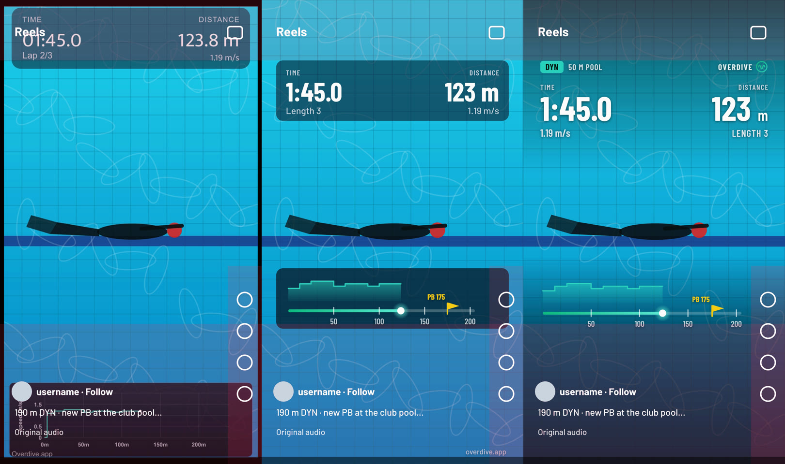
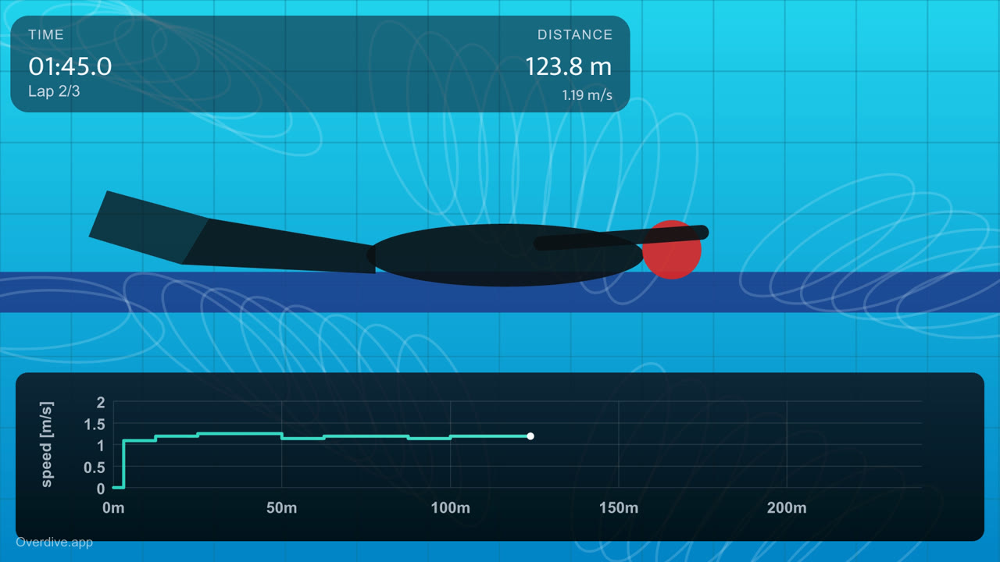
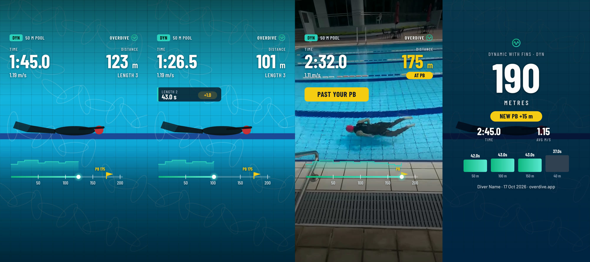
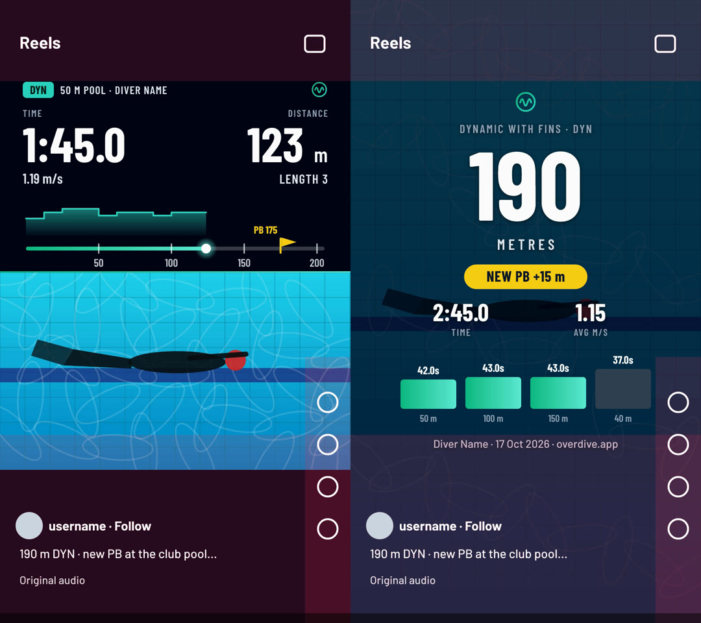
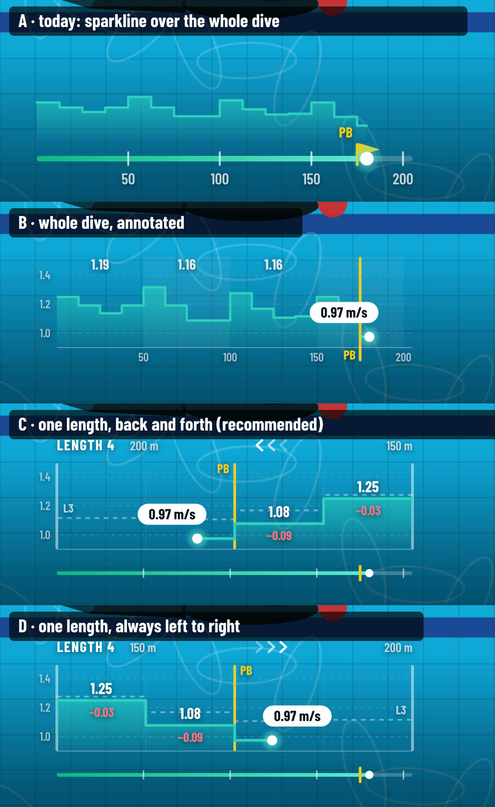
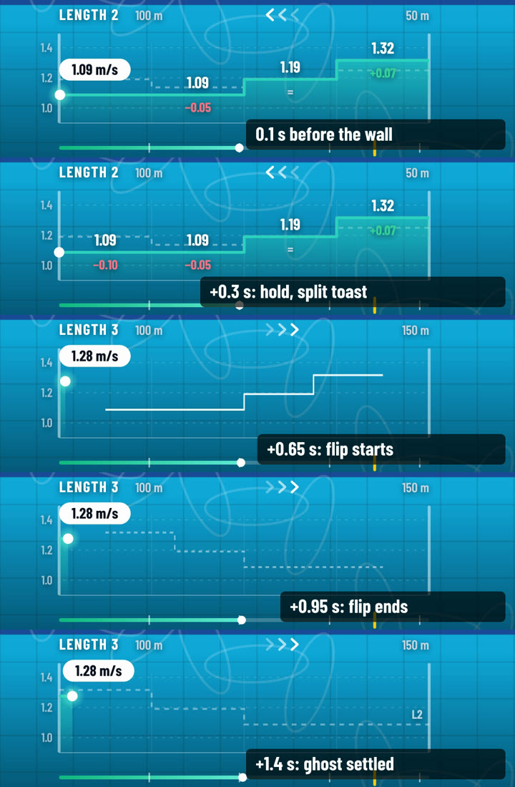
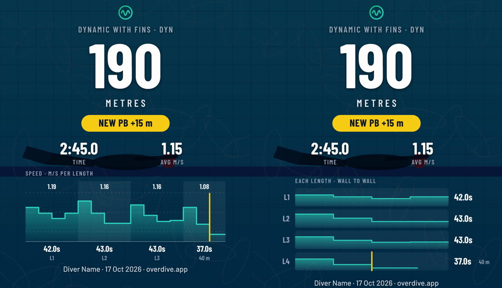

# Share HUD Redesign — Audit and Plan

Status: audit complete, direction selected, Tom's decisions recorded (§8.1), speed graph designed (§4.8), recorder changes added (§4.9). Not started. Written 17 Oct 2026, updated 18 Oct 2026.

Scope: what a user actually gets when they download a dynamic dive with the HUD on, and how to make it look better, read better, and share well on Instagram. Covers the server-burned export first (that is the artefact that leaves the app), then in-app playback.

Related docs: [Burned HUD parity](burned-hud-parity-plan.md) (how the server SVG→PNG→FFmpeg pipeline came to be), [Speed plot HUD overlay](speed-plot-hud-overlay.md) (current graph spec), [Portrait recording](portrait-recording.md).

Images live in [`fixtures/share-hud-redesign/`](fixtures/share-hud-redesign/). Real-footage renders are in `fixtures/share-hud-redesign/local/`. That folder is git-ignored because it contains athlete footage and the repo is public.

---

## 1. How the audit was done

- Re-ran the **production overlay renderer** locally. `overlaySvg()` was extracted verbatim from `functions/src/mediaWorker.ts` (style `overdive-overlay-v14`), rendered with the same `@resvg/resvg-js`, and composited with the same FFmpeg filter graph.
- Footage: a 197 s poolside-walking DYN clip in a 50 m pool (portrait display), plus stock landscape pool footage. The timeline was hand-fitted to the visible wall touches. It gives about 190 m, and the PB was set to 175 m.
- Checked against an **approximate Instagram Reels UI overlay**: header, right-hand action column, caption/username/audio block. Red zones in the images mark where Instagram covers the video.
- Prototyped three design directions in the same renderer (`resvg` + FFmpeg), so everything below has been proven to work in the server pipeline, not just in a design tool.
- Tools (all free): ffmpeg/ffprobe, resvg-js (already a dependency), Barlow / Barlow Condensed fonts (SIL OFL, Google Fonts). Prototype code is in `fixtures/share-hud-redesign/prototype/` (see §10).

---

## 2. What users get today



*Left: today's portrait export (590×1080, upscaled the way Instagram will). Middle: Direction A. Right: Direction B (selected). Red tint = covered by Instagram UI.*



*Today's landscape export (1920×1080). The two panels cover about 50% of the frame.*

### 2.1 Instagram fit (the biggest problems)

| # | Finding | Evidence |
|---|---|---|
| I1 | **Portrait exports are 590×1080, not 1080×1920.** `scaledDimensions(displayDimensions, 1080)` fixes the *height* at 1080, so portrait clips come out at 0.55 of Reels resolution. Instagram upscales them, and they look soft next to native Reels. | `mediaWorker.ts` `generateOverlayDownload` |
| I2 | **The top metric box sits under Instagram's "Reels" header and camera icon.** It starts about 2% from the top. Instagram's header covers roughly the top 12–14%. | image 01, left |
| I3 | **The whole speed graph and the `Overdive.app` watermark sit under the caption/username/audio block.** Instagram covers roughly the bottom 30–35%. The graph is the most distinctive thing we draw, and it's invisible on Instagram. | image 01, left |
| I4 | **Landscape clips posted to Reels** get letterboxed into a thin strip with large black bars, and the HUD shrinks with them. Nothing uses the empty 9:16 space. | `00-current-landscape.jpg` |
| I5 | **No closing moment.** The HUD freezes on the final numbers while the clip runs on. There's no result card, so the most shareable frame (and the best Reel cover) doesn't exist. | `local/current-burn-strip.png` |
| I6 | **No context for a viewer outside the app.** Nothing says which discipline, pool length, whose dive, or whether it was a PB. To an Instagram viewer "1.19 m/s" means nothing, while "PB" and "190 m" mean a lot. | all frames |
| I7 | **The whole clip is exported, including about 15 s of standing at the wall before GO and the surface protocol.** That's about 3:17 for this dive. Reels are capped at about 3 minutes, and long idle intros hurt retention. | timeline vs. duration |

### 2.2 Data presentation

| # | Finding |
|---|---|
| D1 | **`Lap 2/3` gives the result away from the first frame** (the total is known in advance). It's also ambiguous: in a 50 m pool, "lap" can mean a 50 m length or a 100 m out-and-back. |
| D2 | **Distance shows false precision** (`123.8 m`). Between taps it's linearly interpolated, so the decimal is invented. Whole metres while live, exact distance on the end card. |
| D3 | **Time format `01:45.0`.** The leading zero is noise. Sports graphics use `1:45.0`. |
| D4 | **The speed graph uses a fixed 0–2 m/s y-axis.** Real dives sit around 0.9–1.4 m/s, so the line is flat and the variation (which is the interesting part) is crushed into a few pixels. The axis labels, `speed [m/s]` title and gridlines take most of the space and read as a lab chart, not a sports graphic. |
| D5 | **The x-axis domain defaults to 200 × 1.2 m and the server draws no PB marker** (no PB snapshot in the job). The most motivating reference line, the PB, is missing from the exported video. |
| D6 | **The in-app PB is the *current* PB.** If this dive *was* the PB, the marker sits exactly at the finish and "PB" stops meaning "the number to beat". We need the PB *before* this dive. |
| D7 | **Splits are never shown.** Per-length times are how freedivers and coaches talk about pacing ("43 / 43 / 42"). The data exists (`laps[].splitMs`) but it's buried in the graph. |
| D8 | **Speed in m/s is the headline secondary metric.** It's fine for analysis but not something most viewers relate to. Better as a small detail, with split times doing the pacing story. |

### 2.3 Visual design

| # | Finding |
|---|---|
| V1 | System font stacks (`DejaVu Sans` / `DejaVu Sans Mono` on the server, SF on iOS). The mono numerals look dated and differ between in-app and burned output. |
| V2 | Two heavy rounded rectangles ("boxes on video") rather than a scrim/typographic treatment. On the landscape export the boxes cover the swimmer's lane. |
| V3 | Low type hierarchy: labels, values and sub-values are all weight 400. The numbers don't "pop" at thumbnail size. |
| V4 | Inconsistent graph text weights between portrait (400–450) and landscape (600). |
| V5 | No brand presence beyond a 60%-opacity `Overdive.app` in the corner, which Instagram covers anyway. The app icon (teal ring + wave) is never used. |

### 2.4 Technical

| # | Finding |
|---|---|
| T1 | **Font loading per frame.** `new Resvg(svg, { font: { loadSystemFonts: true } })` runs for every frame (10 per second of video). Locally, 1,981 frames at 590×1080 took **6 m 11 s**, of which **5 m 35 s was system time** (font discovery). With 6 bundled font files and `loadSystemFonts: false`, the prototype renders **1080×1920** frames at **about 60 ms each** (361 frames in 22 s). On the 2 vCPU worker this is the difference between fitting and not fitting in the 540 s function timeout. |
| T2 | **resvg ignores `font-variant-numeric` and `font-feature-settings`.** Barlow's default digits are proportional (measured: `H1111H` = 397 px vs `H0000H` = 537 px at 200 px). Any proportional font will make the running clock and distance jitter sideways in the burned export. Fix: bake tabular figures into the bundled font (fontTools `pyftfeatfreeze -f tnum`, free), or lay digits out in fixed-width cells in the layout model. |
| T3 | **Three HUD implementations to keep in sync:** `metricHudFrame` + `speedPlotHud` (app), `overlaySvg` (server SVG, hand-copied constants) and `overlayAss` (ASS fallback). The worker also vendors its own `distanceAt` / `speedAt` / `diveElapsedAt`. Every visual change has to be made 2–3 times. |
| T4 | The style version is duplicated (`SERVER_OVERLAY_STYLE_VERSION` in the app, `OVERLAY_STYLE_VERSION` in functions). |

### 2.5 What's good and worth keeping

- **Server-side background rendering** with upload-time queueing, signed-URL downloads and style-version invalidation. That's the right architecture, and the redesign builds on it.
- **SVG → resvg → PNG → FFmpeg overlay works** and is deterministic. All prototypes here used exactly that path.
- **Pure timeline maths** (`src/lib/capture/timeline.ts`) and the data-oriented frame models are a solid base for a shared renderer.
- `navigator.share({ files })` already gets the MP4 into the iOS share sheet, and Instagram is a target there.

---

## 3. Design directions considered

|       | Direction                | Summary                                                                                                                                                                                                                                                                                                                                                    | Verdict                                                                                                                                                          |
| ----- | ------------------------ | ---------------------------------------------------------------------------------------------------------------------------------------------------------------------------------------------------------------------------------------------------------------------------------------------------------------------------------------------------------- | ---------------------------------------------------------------------------------------------------------------------------------------------------------------- |
| A     | **Refined classic**      | Keep today's two-panel layout. Move both panels into the Instagram safe zone, export 1080×1920, use Barlow, fix the data formats, swap the lab chart for a progress rail.                                                                                                                                                                                  | Cheap and a clear improvement, but it's still "boxes on video" with no story. Good fallback if time is short.                                                    |
| **B** | **Broadcast**            | Cinematic scrims instead of boxes. Big condensed numerals. Discipline/pool/brand header strip. Event-driven moments (split toasts on each wall, a PB-crossing moment). A progress rail with a PB flag and an auto-scaled speed graph (refined in §4.8). A closing **result card** that doubles as the Reel cover. Everything inside Instagram's safe zone. | **Selected.** Looks like sport TV graphics, tells the dive as a story (approaching the PB, split by split, result), and the result card is the shareable payoff. |
| C     | **Stacked story canvas** | For landscape sources: a 9:16 canvas with the video as a band in the middle and data panels in the space above, instead of overlaying the action.                                                                                                                                                                                                          | **Adopted as B's landscape layout.** It turns Instagram's letterbox bars into useful space and keeps the swimmer unobstructed.                                   |
| D     | Static share card only   | Skip video overlays and export a PNG summary card.                                                                                                                                                                                                                                                                                                         | Rejected as the main deliverable, because video is what performs on Reels. The result card can still be exported as a still (phase 4).                           |
| E     | Ghost PB racer           | A second dot on the rail shows where the diver was at the same elapsed time during their PB dive.                                                                                                                                                                                                                                                          | Strong future add-on (phase 5). It needs a PB dive with a timeline.                                                                                              |



*Direction B: mid-dive; split toast after a wall (`LENGTH 2 · 43.0 s · +1.0` vs. previous); PB crossing (distance turns gold, `PAST YOUR PB` moment); result card.*



*Left: B's stacked layout for landscape sources. Right: result card under the Instagram UI.*

A 36 s real-footage sample of Direction B (PB crossing → finish → result card) is at `fixtures/share-hud-redesign/local/broadcast-sample-150-186s.mp4` (local only).

---

## 4. Selected direction: "Reel-first broadcast"

### 4.1 Principles

1. **Instagram Reels is the primary target.** Design at 1080×1920 and adapt elsewhere, not the other way round.
2. **Nothing important in the danger zones.** Every live element sits inside the safe area (§4.3).
3. **Tell the dive as a story, not a chart:** where am I, how fast is each length, how close is the PB, and what's the result.
4. **Typography over boxes.** Gradient scrims and drop shadows for legibility. Panels only for transient toasts and the result card.
5. **Honest numbers.** No invented decimals and no spoilers.
6. **One renderer.** A single pure model, layout and SVG pipeline used for server export *and* in-app playback.

### 4.2 Downloads

The user can download three versions of every dive video (Tom, 18 Oct 2026):

| # | Download | Canvas | Content | Status |
|---|---|---|---|---|
| 1 | **Original** | Source | The full recording, no HUD | Exists today (the `clean` download in `DiveVideoPlayer`) |
| 2 | **Full with HUD** | Source framing, short edge 1080 (portrait 1080×1920-ish, landscape 1920×1080) | The full recording with the broadcast HUD in the native layout: header strip and stats top-left, speed graph and rail along the bottom inside a 5% margin. The result card is **appended** as a 3 s hold after the last frame (FFmpeg `tpad=stop_mode=clone` behind the card), so it never covers the surface protocol. No hook. | Replaces today's burned export |
| 3 | **Social cut** | 1080×1920, 9:16 | An edited highlight optimised for Instagram viewing time (§4.2.1), with the result card after the surface protocol | New |

The social cut uses the reel canvas. Portrait-display sources are scaled to cover (centre-crop). Landscape sources use the **stacked** layout (video band 1080×608 at y≈840 on a deep-navy canvas, data above).

The result card as a still (1080×1350 4:5 and 1080×1920 PNG) stays a phase 4 extra.

#### 4.2.1 Social cut edit

Tom's structure: the start and a few strokes, fast-forward to each wall, normal speed for a few seconds either side of each turn, then surfacing and the surface protocol, and only then the result card.

| Piece | Source window | Speed |
|---|---|---|
| Start | `diveStartMs − 2 s` … `diveStartMs + 3 s` | 1× (hook overlay in the first 1.5 s if on) |
| Between turns | everything not covered by a 1× window | Fast-forward, one factor for the whole cut, chosen from 4/6/8/12/16× to hit the target length. A `12×` badge sits under the header strip. |
| Each wall turn | `wall − 1.5 s` … `wall + 1.5 s` | 1× |
| Finish and protocol | `diveEndMs − 2 s` … `protocolEndMs` | 1× |
| Result card | 3 s hold on the last protocol frame | n/a |

- **The HUD always shows real dive time and distance.** During fast-forward the clock visibly runs fast, which reads as "sped up" without extra explanation. Split toasts and the speed graph's turn animation fire at the 1× turn windows.
- **Target length: 30–45 s, including the card** (Tom, §8.1 Q6). Pick the smallest fast-forward factor that brings the cut to 45 s or less. Worked example (this dive: 165 s, 3 turns, protocol done 10 s after surfacing): the 1× pieces are 5 + 9 + 12 = 26 s, the remaining 151 s of dive at 12× is about 13 s, and the card is 3 s, so the cut is about 42 s. Short dives (one or two turns) land nearer 30 s on their own.
- **Long dives with many turns** (e.g. 25 m pools): if the 1× pieces plus the card exceed about 33 s, keep 1× windows only for the first turn, the turn before the PB is passed and the last turn. All other turns are fast-forwarded too.
- **Fast-forward cap: 16×.** Faster than that, the footage reads as a blur. If the cut is still over 45 s at 16×, drop the middle of the longest fast-forward stretches with a 200 ms cross-dissolve (a jump cut). The HUD clock jumps with it, so the time stays honest.
- **Audio:** original audio at 1×, muted during fast-forward, with 150 ms fades at each join. The protocol ("I'm OK") keeps its sound.
- **`protocolEndMs`:** recorded by the new **Protocol done** tap in the recorder (§4.9.1). For older videos, and for recordings stopped without the tap, default to the end of the recording, clamped to at most `diveEndMs + 15 s` (AIDA's 15 s protocol window). The share preview keeps a draggable end handle as an override.
- The edit is a pure **edit decision list** (`socialCut.ts`: `(timeline, protocolEndMs, options) → { segments: { fromMs, toMs, speed }[] }`), rendered by FFmpeg (`trim` + `setpts` per segment, then `concat`). HUD frames are rendered per *output* frame from the mapped source time, so the cut needs far fewer HUD frames than the full video.

### 4.3 Safe zones (reel canvas, 1080×1920)

Based on Meta's published Reels guidance (keep text out of roughly the top 14%, bottom 35% and side 6%), adjusted for organic posts, which have a shorter caption block. **Re-verify against current Meta docs before implementation.**

- **Top reserved:** y < 250 (Instagram header).
- **Bottom reserved:** y > 1340 (username, caption, audio).
- **Right reserved:** x > 940 for y > 1100 (like/comment/share/remix column).
- **Side margin:** 70 px.
- **Profile-grid crop:** Instagram's grid shows the centre 3:4 (y 240–1680). The header strip and primary stats (y 250–580) fall inside it, so the grid thumbnail shows the numbers.

### 4.4 Layout (reel, full-bleed)

| Element | Position | Content |
|---|---|---|
| Top scrim | y 0–720 | Black gradient, 62% → 0% |
| Header strip | y 250–302 | Teal discipline pill (`DYN` / `DNF` / `DYNB`), `50 M POOL`; right: `OVERDIVE` wordmark + ring icon. Branding is on **every frame but subtle** (about 70% opacity, no panel). It's a single `branding: 'subtle' \| 'off'` flag in the layout, so a paid tier can remove it later. |
| Primary stats | y 340–580 | Left: `TIME` label + `1:45.0` (Barlow Condensed Bold, 140 px). Right: `DISTANCE` + `123` (140 px) + `m` (64 px). Under them: speed `1.19 m/s` (left), `LENGTH 3` (right) |
| Event toasts | y 520–590, in the stats row | Split toast (§4.6) or PB moment. A compact 64 px pill that **temporarily replaces the speed / `LENGTH n` line** instead of taking its own band below the stats. This keeps y 600–1040 free for the diver (§4.9.2). The audit mock-ups show the earlier y 640–744 position. |
| Speed graph | y≈1050–1270, x 124–900 | **One pool length per screen, tracing back and forth** with labelled segment speeds and the previous length as a ghost. Full spec in §4.8. |
| Progress rail | y≈1316, x 124–900 | Thin whole-dive rail (8 px): teal fill to current distance, a tick at each pool length, gold PB tick, white current dot. No labels; it gives whole-dive context while the graph zooms into the current length. |
| Bottom scrim | y 1060–1920 | Black gradient 0% → 70%, which also sits under Instagram's caption |

Stacked landscape: the header strip, stats and rail move into the top panel (y 250–800), with the video band below. Toasts sit bottom-left inside the video band.

### 4.5 Typography and colour

- **Fonts:** Barlow Condensed (Bold 700 for numerals, SemiBold 600 for labels with 2–3 px tracking) and Barlow (Medium/SemiBold for small text). SIL OFL. Bundle the TTFs with the functions deploy and the web app. **Freeze tabular figures** into the numeral font (T2).
- **Colour tokens:** text `#ffffff` / labels `#cbd5e1`; brand teal `#2dd4bf` → green `#10b981` gradient (from the app icon); PB gold `#facc15` (text on gold `#111827`); faster split `#34d399`; slower split `#fbbf24`; panels `#0b1220` at 78%.
- **Legibility:** drop shadow (`dy 3, blur 6, 55% black`) on all text over video; scrims behind the stat zones.

### 4.6 Moments and motion

All motion is a pure function of `atMs`, so playback, export and scrubbing always agree.

- **Split toast:** on each wall touch (`laps[]`), show `LENGTH n · 43.0 s` plus a delta pill vs. the previous length (`−0.6` green / `+1.0` amber; none for length 1). 250 ms fade/slide in, 3.8 s hold, 400 ms fade out.
- **PB approach** (if `pbBeforeM` exists): the flag label reads `PB 175`. In the final 10% before the PB, the flag pulses.
- **PB crossing:** a gold `PAST YOUR PB` toast for 3 s. The distance numerals turn gold, and the right-hand sub-label becomes `+12 m PB`.
- **Finish:** at `diveEndMs`, numerals hold for 0.6 s, then cross-fade into the **result card**.
- **Result card:** dims the video to 26%, then shows: icon; `DYNAMIC WITH FINS · DYN`; distance (270 px) + `METRES`; `NEW PB +15 m` badge (or `PB 175 m · −12 m`, or nothing if there's no PB); total time and average speed; the **full-dive speed graph** with length bands, average speed per length above and split time per length below (§4.8.4; it replaces the split bars); `Name · date · overdive.app`. It shows after the surface protocol: appended after the last frame in the full HUD download, after `protocolEndMs` in the social cut.
- **Hook** (first 1.5 s, only if `pbBeforeM` exists): `PB ATTEMPT · 175 m TO BEAT`. **Social cut only**, on by default there with a toggle. Never in the full HUD download.

### 4.7 Data rules

| Value | Live format | Result card |
|---|---|---|
| Time | `m:ss.t` (`45.3` under a minute) | `m:ss.t` |
| Distance | whole metres, floored | exact realised distance, 0 dp unless it has a fraction |
| Speed | `x.xx m/s` (small) | average `x.xx` |
| Position | `LENGTH n` (current length, 1-based, never `/total`) | split time per length under the full-dive graph (§4.8.4) |
| PB | `pbBeforeM`: best standard distance PB **before this dive** | badge |

### 4.8 Speed graph

The speed graph is the one thing no other app draws, but today it's hard to read actual speeds off it (Tom, §8.1 Q5; audit D4). Tom also asked whether the x-axis should cover one 50 m length that clears and traces back the other way after each turn, with the full graph only on the result card. This section is the result of prototyping that against the alternatives in the production renderer (`prototype/speedgraph.ts`).

#### 4.8.1 What the data can support

- Speed is only known **per waypoint segment**: the time between two taps (walls plus mid-pool splits, e.g. every 12.5 m) over the distance between them. `DiveTimeline.samples` exists in the type, but `appendSample` is never called by the recorder, so real dives have no denser data. A **stepped line** is therefore the honest shape. Smoothing would invent detail.
- Dives tapped with walls only have one step per length. The graph still works, but then it's really a split chart.
- Speeds within a dive vary by about ±0.15 m/s, so the y-axis must be **auto-scaled to the dive**. The prototype uses `floor(min − 0.05)` … `ceil(max + 0.05)` to 0.1 m/s, fixed for the whole video so every length is drawn on the same scale.
- The segment after the last tap (dive ended mid-length) is an estimate (`totalDistanceM` extrapolates). Draw it dashed and label it `~0.97`.

#### 4.8.2 Options compared



*Same moment (170 s, length 4, just past the PB) in each option. Synthetic background; the fixture timeline has realistic splits: fast off each wall, fading through the length and over the dive.*

| | Option | Readability | Verdict |
|---|---|---|---|
| A | Today's direction-B sparkline across the whole dive | Shape only. 16 steps in 820 px, no numbers. You can see "it slowed down" but not by how much. | Replace |
| B | Whole dive, annotated: guide lines with values, average speed per completed length, live speed tag at the cursor | Better. Per-length averages are readable, but a 12.5 m segment is only 50 px wide, too narrow to label, and the PB line competes with the tag. | **Use on the result card** (complete dive, no live cursor) |
| C | **One length per screen, back and forth** (Tom's idea, refined) | Best. Each 12.5 m segment is about 200 px wide, so every segment gets its speed and a delta vs the previous length. The line moves the same way as the diver. | **Selected for the live HUD** |
| D | One length per screen, always left to right | Same readability as C. It never matches the diver's on-screen direction for more than every other length. | Fallback if direction proves unreliable (§4.8.5) |

Tom's "clear the line at each turn" works better with one change: **keep the previous length as a faint dashed ghost** instead of clearing completely (approved by Tom, §8.1 Q7). Comparing this length with the last one at the same point in the pool is the most useful thing the graph can show, and it's what the per-segment deltas are measured against.

#### 4.8.3 Live graph spec (option C)

- **Frame:** the graph is a picture of the pool. Two white wall posts at x 124 and 900, a baseline, faint ticks at the waypoint spacing. Header row: `LENGTH 3`, the wall distances above their walls (`100 m` … `150 m`), and three chevrons pointing in the swim direction.
- **Direction:** length 1 runs in the direction set for the video (§4.8.5). Each later length reverses.
- **Scale:** dive-wide auto y (§4.8.1), two dashed guide lines labelled outside the left wall (e.g. `1.0`, `1.2`).
- **Line:** stepped teal line, 6 px, with the gradient area fill. It grows from the wall the diver pushed off.
- **Segment labels:** each completed segment shows its speed (`1.17`, Barlow Condensed Bold 34 px, white) above the step. Under the step is the delta vs the same segment of the previous length (`−0.02` rose `#fb7185`, `+0.02` green `#34d399`, `=` grey). Rose rather than amber keeps gold exclusive to the PB.
- **Cursor:** white dot plus a white pill tag with the live speed (`1.12 m/s`). The tag flips side near the far wall.
- **Ghost:** the previous length as a 4 px white dashed line at 38% opacity, **aligned by distance off the wall** and labelled `L2` at the far end. Only one ghost is shown.
- **PB post:** a gold vertical post appears only in the length that contains the PB (`PB 175`, then `PB` once passed). The rail below always shows the PB tick.
- **Turn animation** (pure function of `atMs`):
  1. Wall touch to +500 ms: **hold**. The finished length stays fully drawn with all its labels and the cursor pinned to the wall. The split toast appears at the same time, so the cursor tag is hidden.
  2. +500 to +1100 ms: **flip**. The finished line loses its labels and mirrors horizontally around the graph centre (ease-in-out `scaleX` 1 → −1) while fading to ghost opacity. The old ghost fades out. In C the flip is what aligns the ghost by distance off the wall, and it echoes the diver's turn. In D it's a plain fade.
  3. The new length's line starts from the wall underneath.



*The turn from length 2 to length 3 in option C.*

- **Pool lengths:** the graph always shows one pool length (25 m pools: one 25 m length, usually 2 segments, each labelled). Pools longer than 50 m aren't a case for this app.
- **Layouts:** reel (full-bleed and stacked) as above. Native landscape uses the same component along the bottom of the frame (proposed: bottom 22%, at the 1080-wide reference scale; not yet prototyped). It also works in-app (phase 3) with no changes, because it is the same SVG.

#### 4.8.4 Result card graph (option B, complete)



*Left (selected): the whole dive unfolded, with length bands, average speed per length above and split time below, plus the PB post. Right: one row per length aligned wall to wall. It's good for coaching but too small to read on a phone card.*

The whole dive unfolded is what Tom described ("only once the dive is complete is the full speed graph displayed"), and it tells the full story in one image. The stacked-rows view is worth keeping as an **in-app analysis view** (phase 5), where it can be full width and interactive.

#### 4.8.5 Matching the diver's direction

On the real clip the filmer walks along one side of the pool, so the diver's on-screen direction should alternate each length, which is exactly what option C draws. In practice, length 1 swims right to left on screen, so the default (left to right) was wrong for that clip. Even with the direction corrected, a few stretches still disagreed with the footage. In places the diver changes on-screen direction within a single "length", which can't happen without a wall, so these are errors in the clip's hand-fitted wall times, not the design. Either way, a graph running against the diver is visibly jarring. So:

- Store **`firstLengthDirection: 'ltr' | 'rtl'`** per video (default `ltr`).
- In the share preview, show a frame from length 1 with the graph and a one-tap **⇄ Flip graph direction** control.
- If users find this confusing in testing, fall back to option D, which needs no setting.
- Phase 5: infer the direction automatically from motion in the first length (optical flow of the largest moving blob).

A 58 s real-footage render of option C (length 2 → 3 turn, then PB crossing → finish → result card) is at `fixtures/share-hud-redesign/local/speedgraph-lane-sample-94-124-158-186s.mp4` (local only, length 1 set to right to left).

### 4.9 Recorder changes

Two changes to the dive recorder (`DiveRecorder.svelte`, `recorderState.ts`, `recorderSelectors.ts`) from Tom's answer to §8.2 Q3.

#### 4.9.1 Protocol done tap

Today, after **End dive** the recorder enters the `ended` phase ("Surface protocol"). The only button is **■ Stop recording**, and the hint asks the filmer to keep the camera on the diver. Nothing marks when the protocol finished.

Change:

- In `ended`, the primary button becomes **✓ Protocol done** (weight 3), with a small secondary **■ Stop**.
- **Protocol done** dispatches `protocol/done` with `atPerfMs`. The reducer stores `timeline.protocolEndMs` (same recording-relative clock as `diveEndMs`). **Recording keeps going until the filmer taps Stop** (Tom, §8.1 Q9). After the tap the button set goes back to a single primary **■ Stop recording**, with a small `Protocol marked` confirmation. The footage after `protocolEndMs` stays in the full downloads and gives the social cut room for its fade into the result card.
- **■ Stop** keeps today's behaviour, leaves `protocolEndMs` unset, and the social cut falls back to the default (§4.2.1).
- Training mode (`aidaMode === 'training'`) gets the same button. The protocol text only shows in AIDA mode, as today.
- This is independent of the HUD work and starts collecting real protocol times straight away, so it ships in **phase 0**.
- Tests (`recorderState.test.ts`, `recorderSelectors.test.ts`): `protocol/done` is only accepted in `ended`, it's stored once (a second tap is ignored), it doesn't stop the recording, and the `ended` button set changes before and after the tap.

#### 4.9.2 Framing guides

With the overlays now inside Instagram's safe zones, the part of the frame where the diver is unobstructed is smaller. The filmer needs to know where it is **while filming**.

Clear areas per output (reel canvas, 1080×1920, live elements only; the result card is excluded):

| Output | How the phone is held | Covered | Clear band for the diver |
|---|---|---|---|
| Social cut, full-bleed | Portrait | Instagram header (y < 250), header strip and stats (250–590), speed graph and rail (≈1050–1340), Instagram caption (> 1340), action column (x > 940 below y 1100) | **y 600–1040** (about 23% of the height), full width. With the toasts in their audit position (y 640–744) this was only y 760–1040 (15%), hence the toast move in §4.4. |
| Social cut, stacked | Landscape | The data panel sits above the video band (y 840–1448), so it covers nothing. Instagram covers the band's bottom 18% (y > 1340) and its right 13% below y 1100. | The whole band except the bottom-right corner |
| Full HUD download | Either | Native layout: stats top-left, speed graph bottom 22% | The middle of the frame |

The portrait social cut is the most restrictive. If the diver is in its clear band, the other outputs are fine too, so the guide shows the social-cut zones for the current posture.

Design:

- A pure `framingGuide.ts`: `(streamW, streamH, viewportW, viewportH, posture) → { masks: Rect[]; band: Rect }` in **viewport** pixels. It maps the reel-canvas zones through the actual crop chain: the recorded frame → display rotation → 9:16 centre crop (full-bleed) or the stacked band, then into the viewfinder's `object-fit: cover` crop. The viewfinder is itself cropped, so the zones have to come from the recorded frame, not the screen. The zone rectangles come from `layout.ts`, so the guide moves automatically if the HUD layout changes.
- In `ready` and `prepping` (setting up, breathe-up): the covered areas are dimmed (black, about 35%), and the clear band has thin white corner brackets and a one-line hint: *Keep the diver inside the frame*.
- In `diving` and `ended`: the dimming goes and only the brackets stay, at about 30% opacity, so the guide never competes with the waypoint buttons.
- A **Framing guide** on/off toggle in the camera sheet, persisted in `UserSettings` (default on).
- The recorder's own top HUD stays as it is. It's above the guide layer.
- Tests (`framingGuide.test.ts`): portrait and landscape postures, a 16:9 stream in a portrait viewport, a 4:3 stream, and the band lying inside the viewport after the cover crop.
- Needs the phase 1 layout, so it ships in **phase 2**.

---

## 5. Data and schema requirements

1. **`pbBeforeM` snapshot.** Add `shareContext?: { pbBeforeM: number | null; pbSource: 'record' | 'logs' | 'none' }` to the `diveVideos` doc. Set it when the video is created/attached (the client already resolves PBs in `DiveVideoPlayer.resolveDisciplinePbDistance`). If the stored PB record's `routineLogId` equals this video's `routineLogId`, the current record *is* this dive, so derive the previous best from the athlete's earlier routine logs for that discipline instead. Backfill existing videos with a dry-run-first script (`backfill:share-context:dry`).
2. **Athlete display name.** Resolve from `athleteId ?? userId` (not `ownerId`, so coach-gifted clips credit the athlete). Snapshot it into the overlay job payload.
3. **Share options** (per user, in `UserSettings`): `shareHud: { showName: boolean; showPb: boolean; socialHook: boolean }`. Defaults: name on, PB on, social hook on. The hook only ever applies to the social cut.
4. **Protocol end on the timeline:** `DiveTimeline.protocolEndMs?: number`, written by the recorder's Protocol done tap (§4.9.1). Optional, so older timelines stay valid. Mirror it in the vendored `functions/src/lib/timelineToRoutineLog.ts` type until §6.1 removes the copy.
5. **Per-video share edits** (on the `diveVideos` doc, because they depend on the footage): `shareEdit?: { firstLengthDirection: 'ltr' | 'rtl'; protocolEndMs?: number }`. `shareEdit.protocolEndMs` is the user's override from the preview handle. Resolution order: override, then `timeline.protocolEndMs`, then the default in §4.2.1.
6. **Recorder setting:** `UserSettings.recorder.framingGuide: boolean` (default `true`).
7. **Branding flag:** `branding: 'subtle' | 'off'` in the layout input, always `'subtle'` for now. It's a hook for a future paid tier, not a user setting yet.
8. **Discipline labels:** a pure map `DYN → 'Dynamic with fins'`, `DNF → 'Dynamic no fins'`, `DYNB → 'Dynamic bi-fins'`.

Call-outs per repo rules: schema/type change (`DiveTimeline.protocolEndMs`, `DiveVideo.shareContext`, `DiveVideo.shareEdit`, `UserSettings.shareHud`, `UserSettings.recorder.framingGuide`), a new backfill script, a Cloud Functions change, and new storage artefact keys (`overlay/hud.mp4`, `overlay/social.mp4`).

---

## 6. Architecture

### 6.1 One shared HUD module

Create `src/lib/media/shareHud/` (pure, no DOM):

- `model.ts`: `(timeline, poolLengthM, context, atMs) → ShareHudFrame`. Values, current length, last split + delta, PB state, phase (`pre | live | finish | card`), toast states with opacity/offset.
- `speedGraph.ts`: `(timeline, poolLengthM, direction, atMs) → SpeedGraphFrame`. Dive-wide y scale, waypoint segments of the current length, per-segment deltas vs the previous length, ghost, turn phase (`live | hold | flip`) with progress, PB post. The result-card variant is the same function with the complete dive.
- `socialCut.ts`: `(timeline, protocolEndMs, options) → EditDecisionList` and the inverse mapping from output time to source time (§4.2.1).
- `framingGuide.ts` (in `src/lib/capture/`, because the recorder uses it): reel-canvas zones from `layout.ts` → viewfinder masks and clear band (§4.9.2).
- `layout.ts`: `(frame, canvas: { format, width, height, videoRect }) → primitives`. Rects, text runs with explicit font tokens, paths, gradients, all in canvas pixels. Safe zones are data here.
- `svg.ts`: `primitives → SVG string` (used by both the server and `ShareHudSvg.svelte`).
- `tokens.ts`: colours, fonts, sizes at the 1080-wide reference; `SHARE_HUD_STYLE_VERSION`.
- Sibling `*.test.ts` for model and layout: split deltas, PB crossing timing, no-spoiler formats, safe-zone containment assertions (every live primitive inside the safe rect), and digit-cell stability.

**Sharing with functions:** stop vendoring. Add an esbuild step to `functions` (free, tiny) that bundles `functions/src/index.ts` together with imports from `../src/lib/media/shareHud/*` and `../src/lib/capture/timeline.ts`. Then `overlaySvg`, `overlayAss`, the vendored timeline maths and the duplicated style version can all be deleted. The ASS fallback is removed once the new path has had about 2 weeks clean in production.

### 6.2 Server render performance

The budget is a 2 vCPU / 4 GiB / 540 s worker (`processMediaJob`). Fixes, in order:

1. **Fonts once:** `loadSystemFonts: false` and `fontFiles` pointing at the bundled TTFs (T1). This alone is the biggest win.
2. **Frame dedupe:** consecutive frames whose SVG string is identical (pre-dive, result card hold) write a single PNG. Feed FFmpeg a concat list with durations instead of a fixed 10 fps image sequence.
3. **Layer split:** render the static layer (scrims, header strip, labels, rail track and ticks) once as a PNG and overlay it with FFmpeg. Per-frame SVGs then contain only dynamic primitives, cropped to their bounding regions.
4. **Parallelism:** render frames in 2 `worker_threads` (2 vCPU).
5. Keep 10 fps for HUD updates. The tenths digit changes at 10 Hz, so that matches.

Target: a 3-minute dive renders HUD frames in < 90 s and encodes (`veryfast`, CRF 20) in < 180 s on the worker. Measure in phase 1 before pre-generating the full HUD download for every upload. The social cut is cheaper: at most 45 s of output, so only about 450 HUD frames. If the full HUD doesn't fit, raise the CPU on the media function, or generate it on demand only. Raising CPU costs money, so check the [cost guardrails](../storage-infra/firebase-cost-guardrails.md) first and ask Tom.

### 6.3 Artefacts and versioning

- New artefact kinds `hud-full` (replaces today's overlay download) and `social-cut`, keyed by `SHARE_HUD_STYLE_VERSION` plus a hash of the share options and `shareEdit`. Stale or missing artefacts are regenerated through the existing queue.
- Upload-time queue: pre-generate **`hud-full`** as today, if §6.2 fits. `social-cut` is generated on demand from the share sheet, because the user usually adjusts the protocol end and direction there first.
- Timeline correction and `shareEdit` changes invalidate both (extend `saveDiveVideoTimelineCorrection.ts`).

### 6.4 In-app

- `DiveVideoPlayer` live HUD switches to `ShareHudSvg` using the **native** layout. The in-app player and the download match, which retires `metricHudFrame` / `speedPlotHud` / `MetricHudSvg` / `SpeedPlotHudSvg` once migrated.
- **Download menu:** three choices, matching §4.2: *Original (no HUD)*, *Full video with HUD*, *Social cut (Instagram)*.
- **Social cut sheet:** a 9:16 preview that plays the edit at low resolution in the browser, using the same SVG over the video with the edit list. It has the name / PB / hook toggles, a protocol-end handle on a mini timeline, and the **⇄ Flip graph direction** control (§4.8.5). The primary action is **"Share to Instagram"**: it renders or fetches `social-cut`, then opens `navigator.share({ files })` (Instagram appears in the iOS sheet). It also copies a suggested caption to the clipboard, e.g. `190 m DYN · 2:45.0 · new PB (+15 m) 🐬 Tracked with @overdive.app #freediving #dynamicapnea`.

---

## 7. Implementation phases

### Phase 0: groundwork (low risk, ships alone)
- Bundle the Barlow fonts and freeze tabular figures. Switch the current worker renderer to `fontFiles` + `loadSystemFonts: false`. **Verify the render time drop on the worker.**
- Fix the export resolution so the short edge is 1080 (portrait 1080×1920-ish, landscape 1920×1080). Bump the style version.
- Add the functions esbuild bundling so it can import `src/lib/...`.
- Recorder **Protocol done** tap and `DiveTimeline.protocolEndMs` (§4.9.1), so real protocol times are collected before the social cut ships.
- Acceptance: the existing design renders at full resolution, is noticeably faster, and existing tests pass. A test recording made with the Protocol done tap stores `protocolEndMs` and keeps recording until Stop.

### Phase 1: shared model + new full HUD download (MVP)
- `shareHud/model.ts`, `speedGraph.ts`, `layout.ts` (native + reel full-bleed + stacked), `svg.ts`, `tokens.ts` with tests.
- Server `hud-full` job: the whole recording in source framing with the new design and speed graph, result card appended after the last frame, frame dedupe.
- `pbBeforeM` snapshot on new videos (backfill comes in phase 3). `shareEdit.firstLengthDirection` with a simple flip toggle in the player.
- Fixture script: generates committed synthetic-background PNGs for fixed timestamps (pre, mid, toast, turn hold/flip, PB, card) for portrait and landscape. Before/after comparison on every style bump.
- Acceptance: a portrait and a landscape test dive export at short edge 1080. Speed-graph tests pass (segment deltas, ghost alignment by distance off the wall, flip timing, PB post only in its length). No digit jitter (fixture diff). Render plus encode is under 270 s for a 3-minute dive on the worker.

### Phase 2: social cut and share UX
- `socialCut.ts` edit decision list with tests (target length, fast-forward factor choice, turn selection on long dives, output→source time mapping).
- Server `social-cut` job: 1080×1920 reel canvas, `trim`/`setpts`/`concat`, audio muted in fast-forward with fades, hook, result card after `protocolEndMs`.
- Download menu with the three choices. Social cut sheet: preview, toggles, protocol-end handle, direction flip, caption copy, "Share to Instagram".
- Recorder **framing guides** (§4.9.2): `framingGuide.ts` with tests, the viewfinder masks and brackets, and the camera-sheet toggle.
- Acceptance: the fixture dive produces a 30–45 s cut whose turns and protocol play at 1×, and the card appears only after the protocol. Every live primitive is inside the safe zone (unit-tested). On a real phone in both postures, a diver kept inside the guide's clear band is unobstructed in the exported social cut.

### Phase 3: in-app parity
- `ShareHudSvg.svelte` replaces the metric and speed-plot components in `DiveVideoPlayer` (native layout).
- `UserSettings.shareHud` defaults. `pbBeforeM` backfill (dry run first).
- Retire `overlayAss` and the vendored worker maths after 2 clean weeks.

### Phase 4: polish and stills
- Result card still export (4:5 and 9:16 PNG).
- PB flag pulse.
- Native layout tuned for landscape tripod clips (graph kept clear of the lane band).
- QA on real devices: iOS Instagram app upload (Reel + Story), WhatsApp, Android share sheet.

### Phase 5: ideas worth testing (not committed)
- **Ghost PB racer** on the rail (needs the PB dive's timeline).
- **Automatic graph direction** from motion in the first length (§4.8.5).
- **Stacked-lengths analysis view** in-app (§4.8.4).
- Branding off for a paid tier (`branding: 'off'`).
- Optional `@instagram` handle on the result card (profile field).
- Coach-branded result card (club logo) for coach-gifted videos.

---

## 8. Risks and open questions

- **Worker time/cost** at short edge 1080. Mitigated by §6.2. Measure before pre-generating `hud-full` for every upload. Any CPU/memory increase needs Tom's OK (cost).
- **Graph direction mismatch** (§4.8.5): if the user doesn't set it, half of all videos will trace against the diver. Mitigated by the flip control in the preview; option D is the fallback.
- **Protocol end** is wrong if the filmer forgets the Protocol done tap or taps it early. Mitigated by the fallback to the end of the recording (§4.2.1) and the preview's end handle.
- **Narrow clear band in portrait** (y 600–1040 of 1920, §4.9.2). Filmers walking alongside the pool may struggle to keep the diver in it. Watch this in device QA. If it's too tight, shrink the stats (140 → 120 px numerals) or the speed graph height before shrinking anything else. Also judge whether the toasts in the stats row are prominent enough (§8.1 Q10); the provisional decision can be reversed then.
- **Instagram UI changes:** the safe zones are data in `layout.ts` and are easy to retune. The framing guide reads the same data, so it follows automatically.
- **Portrait crop of portrait-display sources:** centre-crop can cut the diver at the edges in some framings. Phase 4 could add a manual vertical offset in the social cut sheet.
- **Privacy:** the name on the result card is on by default but can be switched off. Coach-gifted clips credit the athlete only after the gift is accepted.

### 8.1 Decisions (Tom, 18 Oct 2026)

| # | Question | Decision | Where it landed |
|---|---|---|---|
| 1 | `OVERDIVE` branding on every frame or only the card? | Every frame, kept subtle. A paid version may remove it later. | §4.4 header strip, §5.7 `branding` flag |
| 2 | Hook intro default? | Yes in a social export; not needed in the standard HUD recording. | §4.6 hook: social cut only, on by default |
| 3 | Replace today's HUD download or sit alongside? | Three downloads: full video without HUD; full video with HUD; a social version optimised for Instagram viewing time (start and a few strokes, fast-forward to each wall, normal speed a few seconds either side of each turn, surfacing and surface protocol). The result card only after the protocol. | §4.2, §4.2.1, §6.3, §6.4, phases 1–2 |
| 4 | Barlow Condensed as the numeral face? | Yes. | §4.5 |
| 5 | Speed graph: make segment speeds readable; try a 50 m x-axis that clears and traces back after each turn, with the full graph only at the end. | Explored with four options on real footage. Selected: one length per screen, back and forth, with labelled segments, deltas and a ghost of the previous length; whole-dive graph on the result card. | §4.8 |
| 6 | Social cut length: ≤ 60 s or 30–45 s? | 30–45 s. | §4.2.1: tighter 1× windows, fast-forward up to 16×, jump cuts beyond that |
| 7 | Ghost of the previous length instead of a clean clear? | Yes ("love it"). | §4.8.2, §4.8.3 |
| 8 | Protocol end: default plus handle, or a recorder tap now? | Add a Protocol done tap to the recorder now. Also add framing guides to the recorder, because the overlays now leave a smaller unobstructed area. | §4.9, §5.4, §5.6, phases 0 and 2 |
| 9 | Protocol done: auto-stop 2 s later, or keep recording until Stop? | Keep recording until Stop. | §4.9.1, phase 0 acceptance |
| 10 | Toasts in the stats row (portrait clear band 15% → 23%)? | Yes for now; revisit after device testing. | §4.4, §4.9.2, §8 narrow clear band risk |

### 8.2 Open questions for Tom

None. Re-check the toast position (§8.1 Q10) in device QA.

---

## 9. Test plan summary

- Pure tests: model (split deltas, PB crossing time, phases, no `/total`), layout (safe-zone containment, stacked vs full-bleed placement, digit cells), formatters, social cut edit list, recorder `protocol/done`, framing guide mapping.
- Fixture renders: synthetic background PNGs per state, committed. Real-footage renders stay in the git-ignored `local/`.
- Worker: timing logs for frame render and encode. One end-to-end export in the emulator, or on a staging video.
- Device QA: upload to Instagram Reels and Stories from iOS and Android. Check the safe zones, the cover frame selection and the grid crop. Film one dive in each posture following the framing guide, and check the diver is unobstructed in the social cut.

---

## 10. Reproducing the audit

From the repo root (fonts are downloaded to `/tmp/hud-audit/fonts`, or set `HUD_FONT_DIR`):

```sh
mkdir -p /tmp/hud-audit/fonts && cd /tmp/hud-audit/fonts
for f in barlow/Barlow-{Medium,SemiBold,Bold}.ttf barlowcondensed/BarlowCondensed-{Medium,SemiBold,Bold}.ttf; do
  curl -sfLO "https://github.com/google/fonts/raw/main/ofl/$f"; done
cd -
P=docs/video/fixtures/share-hud-redesign/prototype
$P/extract-current-overlay.sh                                     # copies today's overlaySvg() out of the worker
npx tsx $P/still.ts 590 1080 120000 /tmp/current.png              # today's HUD at t=120 s
npx tsx $P/mock.ts still broadcast 120000 /tmp/b.png              # Direction B overlay
npx tsx $P/mock.ts still end 183000 /tmp/end.png                  # result card
npx tsx $P/mock.ts still stacked 120000 /tmp/c.png 840 608        # stacked landscape (video y, height)
npx tsx $P/mock.ts still ig 0 /tmp/ig.png                         # Instagram UI approximation
npx tsx $P/synthbg.ts 1080 1920 /tmp/bg.png                       # synthetic pool background
ffmpeg -i /tmp/bg.png -i /tmp/b.png -filter_complex overlay /tmp/out.png

# Speed graph study (§4.8). Variants: spark | full | lane | lane-rtl | reset
npx tsx $P/speedgraph.ts still lane 170000 /tmp/lane.png          # broadcast HUD with the one-length graph
npx tsx $P/speedgraph.ts seq lane-rtl 94000 124000 /tmp/seq       # 10 fps overlay frames for a clip
npx tsx $P/speedgraph.ts card full /tmp/card.png                  # result card with the whole-dive graph (or: stacked)
```

The fixture timeline's mid-pool splits were reshaped on 18 Oct 2026 for the speed-graph study (wall times unchanged), so the images in §2–§3 were rendered from the earlier, flatter splits.

`prototype/` is throwaway exploration code (hard-coded timeline, PB = 175 m, 50 m pool). Don't import it from the app. Phase 1 replaces it with `src/lib/media/shareHud/`.
